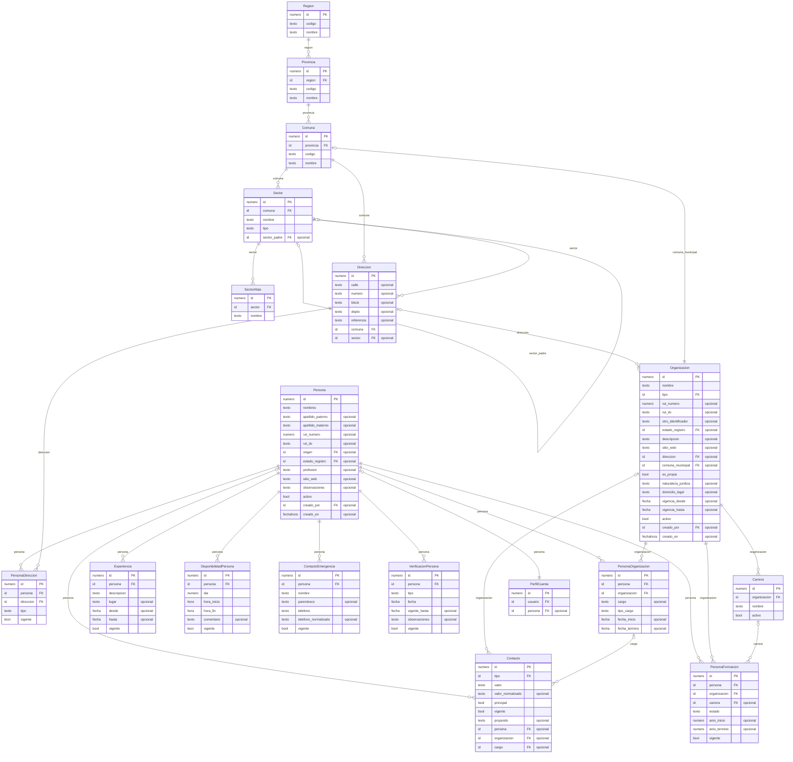
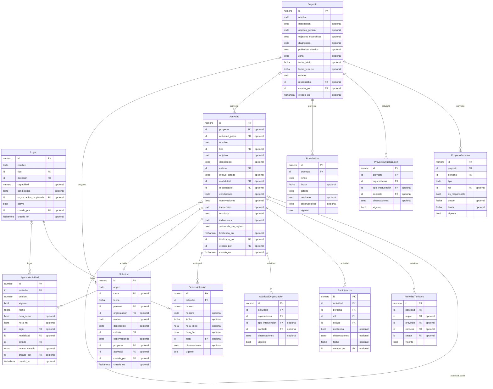
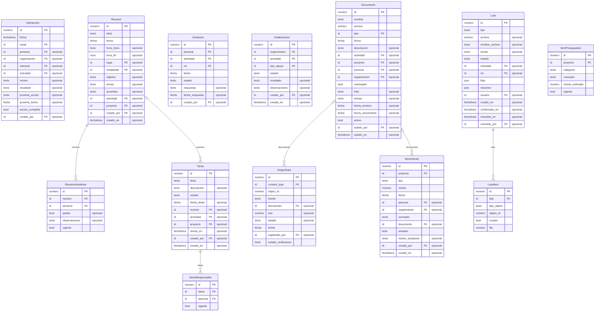

# Modelo de datos (generado)

Generado con `python manage.py diagrama_er` a partir de los modelos de Django. Las tablas de historial (`Historical*`) y los catálogos se omiten del dibujo para que se pueda leer; los catálogos aparecen como `FK` a `nucleo`.

## Territorio, personas y organizaciones

## Lugares, proyectos y actividades

## Coordinación, documentos, importaciones y finanzas

